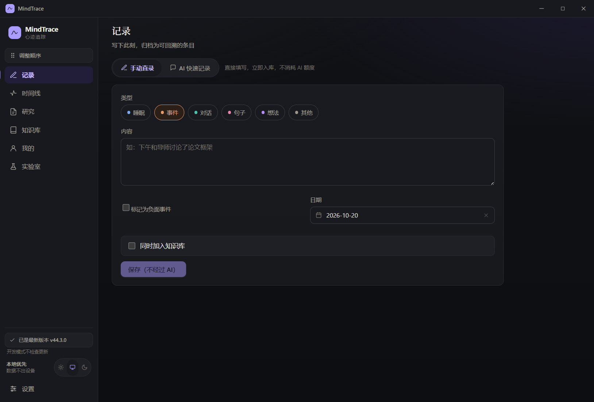

# MindTrace · 心迹追踪

> 一个把「随手记录」变成「可回看的自己」的本地优先桌面应用。

写下的东西，大多活不过三天。

记在备忘录里的心情、聊完就散的对话、读了却想不起为什么收藏的文档——它们都真实发生过，却很少再被翻出来。MindTrace 想解决的就是这件事：**让你写下的每一段，都能在将来某一天被重新找到、重新理解。**

它是一个 Windows 桌面应用。所有记录、知识、报告都存在你自己的电脑里，不上传任何服务器。

---

## 它是什么

一句话：**记录 → 沉淀 → 回看 → 洞察**。

| 你做什么 | MindTrace 做什么 |
|---|---|
| 随手写下一段话 | 自动归档成结构化条目，永不丢失原文 |
| 想不起来某件事 | 按日期、类型、关键词，甚至按「意思」找回 |
| 读到有用的资料 | 收进知识库，写下当时为什么收藏 |
| 想看看最近状态 | 生成日报、周报和生活趋势 |
| 有些事只想记住给自己 | 一键隐藏，从时间线、搜索和统计中消失，但数据还在 |

<!-- 截图: 主界面 -->


---

## 核心能力

### 记录：两种方式，都很快

**手动直录** —— 打开就写，选个类型（睡眠 / 事件 / 对话 / 句子 / 想法 / 其他），按保存。不经过 AI，不消耗任何额度。

**AI 快速记录** —— 把一整段自然语言丢给 AI，它会拆成多条候选，逐条检查后确认归档。适合"我刚跟人聊了很久，想一次性记下来"这种场景。

几个细节：

- 原始文字**永不被修改**，AI 整理结果单独存放，随时能对照
- AI 记录是一个可跨重启恢复的会话，关掉应用再打开，上次的对话还在
- 已归档的内容不会因为你清空会话而消失
- 非睡眠记录可以顺手加入知识库，并指定文件夹

### 时间线：按日回看，也能按意思找

所有记录按天攒在一起，你可以：

- 按类型筛选、按日期范围筛选、关键词搜索
- 语义搜索开启后，用「表达不同但意思相近」的说法也能找回旧记录
- 把不想看到的条目隐藏起来——它们会从时间线、搜索、报告、趋势统计里全部消失，但数据完整保留，随时可以恢复显示

### 知识库：不只收藏，还要记住为什么收藏

知识库不是文件堆。每条资料你都可以写下**收录原因**和**当时的感受**，这让它变成可检索的思考记录。

- 文件夹管理，支持改名、加标签、排序
- 导入 Markdown、TXT、Word、PPT、Excel、HTML
- Markdown 和文本可以直接排版预览，图片会正常显示
- AI 总结、AI 拟标题都只在**你点按钮时**发生，且要你确认才写入
- 可以把 ChatGPT / Claude 官方导出的对话 ZIP 一键导入：整个会话存成一条资料，时间线只留一行摘要；重复导入会自动跳过

### 报告与趋势：看见自己的变化

- 生成**日报**和**周报**，随时导出为 Markdown
- 周度研究：你写下想研究的问题，AI 出题陪你梳理
- 「我的」页面维护个人信息（名称、职业、所在地、目标、兴趣），并查看睡眠、负面事件、记录量的趋势
- AI 识别出的个人资料只会变成**待确认草稿**，你手动填写的永远优先，不会被覆盖

### 实验室：还在打磨中的能力

- 账号关联校验（GitHub / Gitee）
- 其他实验性功能，随时可能调整

### AI 技能中心：把 AI 调成你习惯的样子

AI 的输出风格可以调。在「设置 → AI 技能中心」里，你可以给每类 AI 任务写一段偏好说明，它会附加到该区域的 AI 请求里。

四个互不干扰的作用域：

| 作用域 | 生效位置 | 影响什么 |
|---|---|---|
| AI 快速记录 | 记录页 | 随手记录的拆条粒度、措辞、类型判断 |
| 日报 | 研究页 | 日报的关注点与表述 |
| 周报 | 研究页 | 周报的关注点与表述 |
| 周度研究 | 研究页 | 研究计划出题的思路 |

几个约束，避免你踩坑：

- 每个作用域最多 6 个技能，全库上限 100 个
- 技能只影响**偏好与措辞**，不改数据结构、不改输出格式——格式契约优先级永远高于技能
- 不同页面的技能互相不可见，不会叠加
- 技能是给 AI 的提示，不会改动你的任何记录

---

## 为什么是「本地优先」

很多记录类应用默认把数据放在云端。MindTrace 不这么做。

它**没有账号系统，没有 MindTrace 服务器**。你的数据默认存在这里：

```text
%APPDATA%\mindtrace\data\
```

| 内容 | 存在哪 |
|---|---|
| 记录、时间线、报告、知识库、检索索引 | `mindtrace.db` |
| 每日自动备份 | `backups/`，默认保留最近 30 份 |
| 导出的 Markdown 报告 | 由你在设置里指定；未设置时首次导出会询问 |
| AI 与搜索服务的 API Key | `secrets.bin`，用 Windows DPAPI 加密 |

**关于数据迁移**：设置页可以更换数据目录。迁移前会检查目标路径、写入权限和剩余空间，复制后逐文件校验。旧目录不会自动删除；新目录不可用时，也不会静默创建一个空数据库来"假装成功"。

**关于更新**：正常升级或重新安装不会删除上述数据。不过——在移动目录、恢复备份或大版本升级前，自己再留一份独立备份永远是个好习惯。

---

## AI 是可选的

**不用 AI，MindTrace 也能完整使用**：记录、时间线、知识库、关键词搜索、备份，全部不依赖网络。

需要 AI 时，在设置里选一个服务。下面这些是内置预设，选中后接口地址会自动填好（模型清单核对于 2026-10-20，各家迭代较快，以「刷新账户可用模型」拉到的实时列表为准）：

| 服务 | 预设模型 | 说明 |
|---|---|---|
| DeepSeek | `deepseek-flash`、`deepseek-v4-pro` | 国内直连；`v4-pro` 适合需要多步推理的日报周报生成 |
| 智谱 GLM | `glm-5.3`、`glm-5.3-flash`、`glm-5.2` | 国内直连；支持 1M 超长上下文 |
| Moonshot Kimi | `kimi-k3`、`kimi-k2.7-code`、`kimi-k2.6` | 国内直连；`kimi-k3` 为旗舰，支持 100 万 token 上下文 |
| SiliconFlow 硅基流动 | `DeepSeek-V4.1-Flash`、`DeepSeek-V3.2`、`GLM-5.3` | 聚合平台，一个 Key 就能调多家模型 |
| Ollama（本机） | 你自己 pull 的模型 | 完全本地运行，无需 API Key，内容不出设备；速度取决于本机配置 |
| 自定义 | 手动填写 | 任何兼容 OpenAI 协议的服务，自己填接口地址和模型名 |

选完预设后还能点「刷新账户可用模型」，验证 Key 是否有效，并拉取该账号实际可用的模型列表。

> ⚠️ **服务商会下线旧模型。** 例如 Moonshot 的 `moonshot-v1` 系列已于 2026 年 8 月 31 日全面下线。如果内置预设里的某个模型调不通，点一下「刷新账户可用模型」用实时列表替换即可。

**关于语义搜索**：它需要 Embedding 模型，而聊天模型和 Embedding 模型是两回事。开启时你手动填写模型名（例如 `text-embedding-3-small`、`embedding-2`、`bge-m3`），MindTrace 会复用当前提供商的接口地址和 Key 去调用。

也就是说：**能不能用语义搜索，取决于你选的服务是否提供 Embedding 接口**。设置页的提示里举了 SiliconFlow、智谱、OpenAI、Ollama 作为例子。如果当前服务不支持，语义搜索会失败——但这不影响其他任何功能，关掉它，关键词搜索照常工作。

### 隐私边界，说清楚

- API Key 用 Windows DPAPI 加密存储，不会明文落盘
- 但**启用在线 AI 后，发送出去的内容仍会离开你的电脑**——这是任何在线 AI 的固有事实，无法规避
- 出网脱敏**默认开启**（设置里可关），发送前会尽量减少人名、账号等识别信息
- 实在敏感的内容：用本地 Ollama，或者干脆不启用在线能力

---

## 安装

### 普通用户

不需要装 Node.js，不需要克隆仓库。

**[前往 Releases 下载最新版 →](https://github.com/zrlll2023/MindTrace/releases/latest)**

下载 `MindTrace-Setup-x.y.z.exe`，双击安装。

**系统要求**：Windows 10 / 11（x64）

> 从 v0.3.0 起，正式安装版可以在应用左下角检查并下载新版本。通过源码启动的开发模式不会触发应用更新。

### 从源码运行（开发者）

```powershell
git clone https://github.com/zrlll2023/MindTrace.git
cd MindTrace
corepack enable
pnpm install --frozen-lockfile
pnpm dev
```

需要 Node.js `^20.19.0 || >=22.12.0`（推荐 22）和 pnpm `10.34.5`。

| 命令 | 用途 |
|---|---|
| `pnpm dev` | 启动开发环境（Vite + Electron） |
| `pnpm mock` | 启动本地 Mock AI 服务，无需真实 Key 即可调试 |
| `pnpm typecheck` | 类型检查 |
| `pnpm test` | 运行测试 |
| `pnpm build` | 构建前端与主进程 |
| `pnpm dist` | 打包 Windows 安装包 |

根目录的 `启动MindTrace.bat` 是给源码开发用的启动器，不是普通用户的安装入口。详见 [开发版启动说明](scripts/README-launch.md)。

---

## 第一次使用

1. **打开应用**，直接开始记录——不配置 AI 也能用
2. 在**记录**页写下第一条：选类型、写内容、保存
3. 去**时间线**看看它长什么样，试试筛选和搜索
4. 有值得留下的东西，就收进**知识库**，写下为什么
5. 想用 AI 时，再去**设置 → AI 服务**填 Key
6. 攒了几天记录后，在**研究**页生成第一份周报

完整操作说明见 [用户手册](docs/user-guide.md)。

---

## 当前版本

**v0.4.0** —— [查看更新日志](https://github.com/zrlll2023/MindTrace/releases/tag/v0.4.0)

本版重点：

- 完善 AI 快速记录归档流程，解析结果可稳定写入时间线与知识库
- 保存后保留解析结果并显示完成反馈，支持一键撤回
- 自动识别、恢复和保护 AI 快速记录目录，避免误删与重复导入
- 修复知识资料编辑的「假成功」问题，摘要随正文同步更新
- 优化清空对话、消息时间定位与发生时间选择
- 完善睡眠时间、生活趋势、报告导出与实验室设置的可靠性
- 日报与周报统一使用宋体，保持原有字号与层级

---

## 技术栈

面向开发者：Electron 44 · Vue 3 · TypeScript · Vite 8 · Pinia · vue-router · sql.js（WASM SQLite，全项目零原生模块）· Vitest · electron-builder · NSIS · electron-updater

AI 侧兼容 OpenAI 协议的 Chat Completions / Models / Embeddings 接口，另支持全文检索、Embedding 语义检索、分块召回与 RRF 融合。

---

## 反馈

遇到问题或有功能想法，欢迎在 [Issues](https://github.com/zrlll2023/MindTrace/issues) 提出。

> ⚠️ **请注意**：不要在 Issue、截图或日志中粘贴真实 API Key、私人记录或其他敏感信息。如果需要附日志，请先检查是否包含个人内容。

---

## License

[MIT](LICENSE) © 2026 zrlll2023
